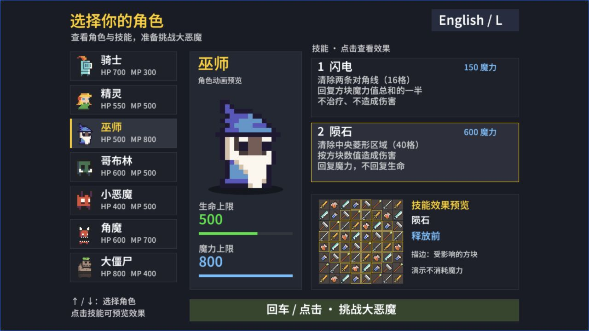

# BattleBlocks 方块战斗

Rust + Macroquad 的单机三消战斗游戏，保留原有像素素材。传统横向/纵向三消、重力下落和连锁；7 个玩家角色对战大恶魔，支持中文和英文。



## 安装、运行与打包

需要 Rust stable（通过 rustup 安装）、Python 3.10+ 和 pip。首次构建会从网络下载锁定依赖与校验后的字体；后续使用本地缓存。Linux 原生音频需要 ALSA 开发包和 pkg-config，例如 Debian/Ubuntu 的 `pkg-config libasound2-dev`，并需要可用的桌面图形环境。macOS 需要 Command Line Tools；Windows 使用 Rust MSVC 工具链及 Visual Studio C++ Build Tools。

```sh
# 一次完成字体工具准备、测试、原生与 Web Release 构建及打包
python3 tools/build.py

# 只构建并打包当前系统的原生版本
python3 tools/build.py --native-only

# 只构建并打包 Web；脚本仍运行原生 Rust 测试
python3 tools/build.py --web-only
```

输出在 `dist/`：

| 运行构建的系统 / 目标 | 输出 |
| --- | --- |
| macOS | `BattleBlocks.app`、`macos-<架构>.zip` |
| Windows | `battleblocks-win32-<架构>/battleblocks.exe` 与 ZIP |
| Linux | `battleblocks-linux-<架构>/battleblocks` 与 ZIP |
| Web | `web/`、`web.zip` |

原生打包针对当前构建主机，不会自动交叉编译其他操作系统。macOS和Web已实际验证；Windows/Linux打包分支已实现，但尚未在对应系统构建、游玩验收。Linux产物依赖系统图形/音频库；macOS包未签名、公证。

首次运行构建脚本后，可直接 `cargo run --release --locked` 启动。打开 macOS 的 `dist/BattleBlocks.app`，或运行 Windows/Linux 对应目录内的可执行文件；原生图像、音效与压缩音乐内嵌，无需另带素材目录。

Web本地运行：

```sh
python3 -m http.server 8765 --bind 127.0.0.1 --directory dist/web
```

访问 http://127.0.0.1:8765/ 。部署时上传 **整个 `dist/web/`**，包含HTML、JS、WASM、`bgm.ogg`、`crush.wav`和licenses目录。不能仅上传WASM：网页流式音乐和音效为外部文件。服务器应为WASM返回`application/wasm`；启用gzip/Brotli可减少传输。首次用户点击/按键解锁声音，符合浏览器播放规则。

`python3 tools/build.py --setup-only` 仅准备字体裁剪工具。build.rs自动扫描Rust源码中的文本、生成中文/英文字体子集；新增文字无需手动裁剪，完整字体不随游戏分发。字体来源校验SHA-256，fonttools固定4.66.1。

已手动完成Release构建时，可 `python3 tools/package.py` 重新打包，或加 `--native-only` / `--web-only`。脚本清理对应旧产物，收集当前目标实际解析的依赖许可，并生成 `dist/measurements.json` 记录字节数。

## 操作与技能

在角色列表中点击，或用↑/↓切换角色；中间显示动画和属性，右侧点击技能或按1/2查看效果示意。预览不消耗魔力。回车或点击挑战按钮开始。点击两个相邻方块交换；普通交换必须形成三消。

- 点击左侧技能按钮，或按 1 / 2 释放技能；空格也可释放第一技能。按钮常驻显示消耗和效果，无需悬停。
- E：角色选择；P：暂停；R：重开；M：静音；L：中英文切换。
- 魔力不足无法释放，连锁动画期间需等待结算。技能先扣魔力，再结算技能收益。

| 角色 / 技能 | 魔力消耗 | 效果 |
| --- | ---: | --- |
| 骑士 · 剑刃斩击 | 100 | 随机清除相邻两列共16格，按方块伤害值攻击，不获得治疗或魔力。 |
| 骑士 · 山崩打击 | 200 | 下次相邻交换附带两侧平行交换，共最多三组；棋盘边缘只交换存在的组，不要求形成三消。 |
| 精灵 · 阴险打击 | 200 | 下次有收益的消除倍率+1，增加治疗、伤害、魔力；重复释放可叠加。 |
| 精灵 · 自然之力 | 125 | 四个随机、不重复位置变为平衡方块；若形成三消则自动结算。 |
| 巫师 · 闪电 | 150 | 清除两条对角线共16格，回复方块魔力值总和的一半，不治疗或造成伤害。 |
| 巫师 · 陨石 | 600 | 清除中央菱形共40格，按方块基础值造成伤害并回复魔力，不治疗。 |
| 哥布林 · 贪婪 | 50 | 随机清除不重复方块，按普通消除规则获得治疗、伤害、魔力及倍率收益。 |
| 小恶魔 · 小恶魔契约 | 100 | 清除所有平衡方块，本次清除无收益。 |
| 角魔 · 角魔契约 | 200 | 随机选一种类型全部清除，每格治疗3、造成3伤害、回复3魔力。 |
| 大僵尸 · 腐化 | 400 | 所有纯伤害方块变为纯治疗方块，混合类型不变；若形成三消则自动结算。 |

清除技能引起的后续下落三消均按普通规则结算。生命、魔力回复不超过角色上限。平衡方块基础收益为治疗3、伤害3、魔力3；纯类型为对应收益10，混合类型为两种收益各5。普通一轮消除倍率为 `max(消除格数 - 2, 1)`，阴险打击另加倍率。

大恶魔每10秒造成20–119伤害并恢复50生命。死亡显示原版“菜”字。

## 目录

- `src/`：游戏逻辑、角色技能与界面。
- `assets/`：直接嵌入的压缩素材、图集元数据、字体许可。
- `asset-sources/`：用于重建图集和音频的原始素材，不随游戏分发。
- `tools/`：构建、字体裁剪、素材转换、打包与内存采样。
- `analysis/`、`docs/`：内存对照实验、数据与审查记录。
- `dist/`：生成的分发包；`target/` 和 `.build-tools/` 为本机构建缓存，均不提交。

`python3 tools/prepare_assets.py`（需要 Pillow）重新生成裁剪、去重后的动画图集，验证还原画布后的帧像素一致性。BGM 重建：`ffmpeg -i asset-sources/bgm.wav -c:a vorbis -strict -2 -q:a 3 assets/bgm.ogg`。

Macroquad 0.4.16 与依赖通过 Cargo.lock 固定；网页 JS 使用匹配的 miniquad 运行时和本项目音频插件，无 CDN。字体 Noto Sans SC 使用 OFL 许可，构建自动裁剪；完整字体仅存本地缓存。

棋盘和格子背景默认用代码绘制，不加载背景图片。绘制使用按纹理分组和512顶点/768索引缓冲；文字使用有限字号与整帧预缓存。内存测量与实际限制见 [内存分析](docs/MEMORY_ANALYSIS.md)、[对照报告](analysis/memory-comparison/REPORT.md)、[字体审查](analysis/memory-comparison/AUDIT.md)。包体积由 `dist/measurements.json` 记录。

原素材美术与音频来源授权仍待核实；构建收集依赖和字体许可。macOS 包尚未签名、公证。

素材是否适合代码绘制、无损缩小验证与实测见 [素材绘制调研](docs/ASSET_RENDERING.md)。

音乐已采用流式原曲：原生CPAL输出、Lewton按包解码、128 KiB固定队列；短音效预解码并与音乐在同一输出中混合。网页音乐使用浏览器媒体播放，音效使用Web Audio。角色选择、暂停、胜负结束暂停音乐；M静音时仍推进播放位置。音频缓冲行为、8-bit试听与优化选项见 [音频调研](docs/AUDIO_OPTIMIZATION.md)。

可试听的流式播放 / 实时合成实验：`python3 tools/prepare_audio_lab.py`，启动网页服务后访问 `/audio-lab/`；原生实验见 [音频实验](analysis/audio-lab/README.md)。
