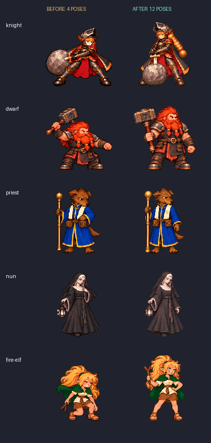
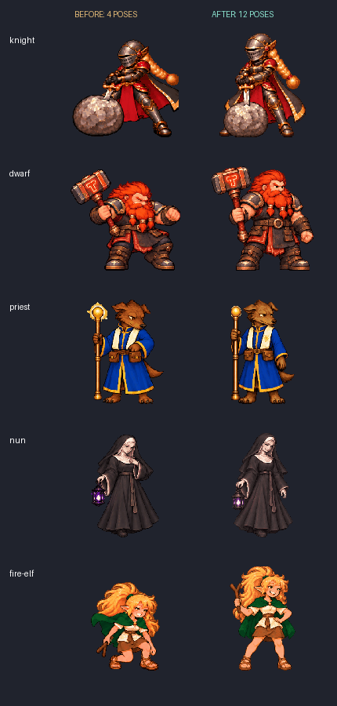

# Issue #11 第一阶段：新五人动画

基线：`3ac9de1da9ee6727c892de941295cd5068a5f109`（已包含技能特效 PR #25）。本阶段覆盖新骑士、矮人、狗头人牧师、修女、精灵火法师；其余七人的原素材保留，Issue #11 继续打开。

## 变化

- 四组动作各 12 个独立姿势，取代四帧动作。前四人：普通／觉醒待机、普通／觉醒施法；火法师：普通／觉醒待机、共用施法、入睡。
- 待机一轮仍是 0.72 秒；施法仍是 1.4 秒。施法和入睡单次播放，结束后保持末帧；睡眠使用进入状态的时间，不依赖全局时钟取模。回滚／重置清理呈现计时。
- 游戏与选人页共用动作采样；跳跃使用休息持锤的十二帧，位移和落地扬尘仍由 #25 的特效控制。
- 图集 2304×3072、单帧 384×384、落脚线 y=336；待机最大可见高度 320；每角色跨形态共享最多 64 色，二值透明、无损 WebP。
- 普通与觉醒复用同一纹理，只保留当前双方的觉醒资源；不预载全部五人的大图集。调试构建只优化现有 `image` 解码依赖，游戏代码保持可调试。
- 生成数据与手写播放逻辑拆开；历史导入入口接到当前版本。独立书层与修女立绘保留可重建入口，使用冻结的原调色板。

## 可视检查

打开 `index.html`（通过项目根目录 HTTP 服务）可以切换动作、暂停和拖动时间条；数据取自运行时同一图集。





对比图固定总施法时长为 1.4 秒，末帧额外停留 0.8 秒后重播，便于审阅；游戏不循环施法。火法师两形态共用施法。所有施法和入睡帧可在 [静态分帧图](cast-contact.webp) 查看。

生成源图、准确提示词及逐帧哈希见各角色 `production` 目录。骑士施法源图 v1 曾出现跨格像素，已生成 v2 修正；导入器现在拒绝任何触及格线的姿势。逐帧、实际缩放尺寸检查已完成，但生成实现稿仍待用户最终视觉验收；不将生成细节倒写为角色设定。

## 当前验证

- `cargo test --locked`：354 passed，1 ignored（仓库原有真实音频设备测试）；包括 240 个姿势的像素差异、共享色板、透明度、锚点、可见高度和一次性动作边界检查。
- `tools/build.py`：单元测试、18 项 Python 平衡工具测试、Windows release、WebAssembly release 及两套打包成功。
- `tools/check_headless.py`：134 条事件，覆盖编辑、移动、施法、回滚、AI、结算；另含两个 autoplay 对局。
- `tools/check_debug_console.py`：305 条原生 GUI 事件，觉醒、角色切换、技能和完整回滚通过。
- `tools/check_new_roles.py`：194 条原生 GUI 事件，矮人、骑士、牧师能力及回滚通过。
- `tools/check_ability_events.py`：修女正常／狂热／觉醒／理智来源链、矮人来源过滤、反馈与完整状态回滚通过。
- 通过内置浏览器打开实际 `dist/web`：图集载入、选角／技能预览正常，未见控制台 error/warn；评审页确认入睡结束保持躺姿。
- `prepare_character_animations.py` 完整重建通过；`prepare_auxiliary_role_assets.py` 重建书层及立绘后与基线无字节差异。
- 调试版未优化解码时启动至首条日志 23.42 秒、触发 15 秒 GUI 测试超时；修正后 2.14 秒，release 2.04 秒（本机单次测量，不是性能基准）。
- Windows 包 `dist/windows-x64.zip`；网页包 `dist/web.zip`。WASM 7,817,585 bytes，网页启动资源 gzip 总计 7,273,464 bytes。

macOS：新增 PR 触发的 `macos-build.yml`。提交 `c79e66b` 在 `macos-15` 的[构建记录](https://github.com/zhouzhouyou/battleblocks/actions/runs/41719477936)已成功：同一构建脚本的测试、原生编译、打包和 headless 验证通过。产物 `macos-arm64.zip`（7,987,584 bytes，`aarch64-apple-darwin`）已下载到本机 `dist/macos-review/`；本机另有 Windows／网页包。macOS 原生窗口交互未验证。

## 独立审查修复

High 档 subagent 独立检查基线、运行时与素材后指出：全局 64 色量化吞掉了修女暗影灯的紫色。已为修女保留八个源图紫色阶、其他 56 色仍共享；新增颜色回归测试覆盖两个暗影 clip 与正常形态区别。修复前运行时紫色像素为 0，源图仍有紫色，故归因于本次导入量化。

独立复核：普通待机／施法每帧紫色像素均为 0，暗影待机每帧 300–395、暗影施法 341–434；角色共 63 个可见 RGB。回归测试按每帧断言，避免个别画面闪回暖灯。复核后无未解决的 P1/P2 阻塞问题；代理未替代主执行者运行 GUI 或 macOS CI。

全量素材入口也补回辅助资产重建调用，避免仅重建角色、漏掉书层与立绘；重建结果与基线一致。

## 复现

用 `.build-tools/python-path.txt` 指定的 Python：

```powershell
& (Get-Content .build-tools/python-path.txt) -m pip install --target .build-tools/art-site -r tools/art-requirements.txt
& (Get-Content .build-tools/python-path.txt) -X utf8 tools/prepare_character_animations.py
& (Get-Content .build-tools/python-path.txt) -X utf8 tools/prepare_auxiliary_role_assets.py
& (Get-Content .build-tools/python-path.txt) -X utf8 tools/review_character_animations.py --baseline 3ac9de1
& (Get-Content .build-tools/python-path.txt) -X utf8 tools/build.py
```

图片源与评审产物不进入游戏包；运行时只嵌入 `assets/` 下的 WebP。

Refs #11
