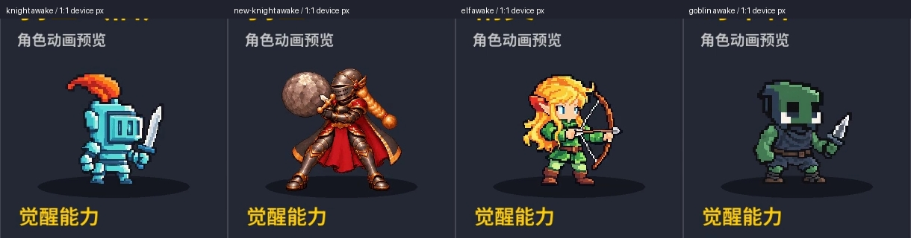

# Issue #28 开工调研与已批准方案

2026-11-05。用户已回复“按你推荐实现”，授权按本方案完成实现、自查、medium 独立审查、修复复验、推送与 Draft PR。本文件保留开工调研与当时的提案语气；实施结果另见 README.md。最终视觉验收仍由用户确认。

## 基线与依据

- 开工执行 `git fetch origin main`，HEAD 与 origin/main 均为 **c0aa438fa4077785706a26276795efbb93e886d6**；工作区起初干净。批准后从这个已核实基线建立 `codex/issue28-awake-animation`。若届时 main 已前进，先报告差异并核对普通版保护数据，不能静默换基线。
- 已阅读 [#28](https://github.com/zhouzhouyou/battleblocks/issues/28)、[#11](https://github.com/zhouzhouyou/battleblocks/issues/11) 的最新正文与全部讨论，以及 [PR #31](https://github.com/zhouzhouyou/battleblocks/pull/31) 最终正文、评论/审查入口、合并实现和仓库验收记录。#28 无讨论；#11 的早期“四组”说法由最新正文覆盖。
- 当前权威：`AGENTS.md`、`docs/art/ART-DIRECTION.md`、`docs/art/CHARACTER-REVIEW.md`。样板只取 `wizard/production/v3`、`tools/prepare_wizard_assets.py`、`src/sprites/animation.rs`、`src/effects/{impact_clock,wizard_spells}.rs` 及 `analysis/issue27-wizard-animation` 最终证据。v1/v2 撤回稿不采用。
- 已读现有角色档案：`KNIGHT.md` 是 ID 7 新骑士，不是本批 ID 0；`FOREST-FIRE-ELF.md` 是 ID 11 火法师，不是本批 ID 1。本批三人目前没有独立角色档案，批准后新建，不覆盖新角色档案。
- 已检索本机 Nowledge Mem 的相关记忆和原始线程，核实用户最后要求为普通版保持不变、觉醒版使用细像素；早期记录中的普通重绘和两形态粗像素方案均已撤回。当前范围以仓库 AGENTS.md、Issue 最新正文和本次批准为准，历史记忆不覆盖这些依据。Codex 本地 MEMORY.md 无相关命中。

## 已做的实测与证据

[research/baseline.json](https://github.com/zhouzhouyou/battleblocks/blob/c3478e146ad4c28485567ee627b2cf1bb4c6e9ef/analysis/issue28-awake-animation/research/baseline.json) 保存基线、源文件和 assets 哈希、三人的普通配置、原始 WebP 哈希、缩略图哈希、二进制哈希、截图采样编号及技能事件时间。

[research/normal-lock.json](research/normal-lock.json) 额外保存逐角色普通播放序列的逐帧RGBA哈希、独立姿势数、缩略图槽位像素和普通注册区哈希。缺血重录确认坚守实际治疗77、换血实际治疗100，均发生在skill事件；坚守消耗发生于0.415564秒。掠夺对手觉醒延迟场景的首次清除为1.522035秒，确实跨过旧1.4秒施法寿命。

本轮使用的 debug 二进制 SHA256 为 `7bdd6acce62b00a766698ceb99b018d02f2d8d74684bb6669e254908852fa92a`，与 #31 已绑定二进制一致；`git diff cf882fe03057b085703adc0c9c4a12651fb7883b c0aa438... -- src assets Cargo.toml Cargo.lock build.rs` 为空。不是宣称本轮重新编译；源码绑定来自合并实现与既有捕获的同一二进制。记录当前工作树字节哈希时保留 Windows 行尾语义。

已通过真实游戏 stdin 控制台录制四位角色觉醒选角、三人六招及掠夺延迟场景，逐项检查日志；取图使用显式 `fps=60`、`fps_mode=passthrough` 的同一采样流。初次两张菜单黑屏已识别并补录，不作为验收输入。以下图为当前基线实际窗口的原尺寸裁剪，不是新方案效果图：

左起：旧骑士、新骑士、精灵、哥布林。[原素材放大检查](https://github.com/zhouzhouyou/battleblocks/blob/c3478e146ad4c28485567ee627b2cf1bb4c6e9ef/analysis/issue28-awake-animation/research/source-inspection.webp)。`research/*-menu.mp4` 与六招同名录像、JSONL 可直接复核。当前战斗截图仍可能带觉醒恢复浮字；正式验收会等浮字退场再录，避免遮住头部。

本轮只证明基线现状与方案所依据的时序，不是新素材验收。未运行全套测试或构建；这些属于批准后的实施门禁。

## 普通版保护清单

三人的原始动画画布均为320×560；运行时沿用各自原裁剪。旧骑士bounds=(0,160,300,560)，精灵=(0,240,320,560)，哥布林=(80,360,280,560)。

| 角色 | ID / 原文件 | 运行时原裁剪帧尺寸 | 独立姿势 / 播放顺序 | 每步时长 / 一轮 | 施法、脚锚 |
|---|---|---|---|---|---|
| 旧骑士 | 0 / knight | 300×400 | 4 / 0,1,2,3 | 100,100,100,130ms / 430ms | cast=None, anchor=None |
| 精灵 | 1 / elf | 320×320 | 4 / 0,1,2,3 | 100,100,100,100ms / 400ms | cast=None, anchor=None |
| 哥布林 | 3 / goblin | 200×200 | **3** / 0,1,2,1 | 130,130,130,130ms / 520ms | cast=None, anchor=None |

锁定每人的 `asset-sources/{knight,elf,goblin}.webp`、`assets/{knight,elf,goblin}.{webp,json}`，`assets/report.json` 相应条目、`assets/hero-thumbnails.webp` 整张字节及 ID 0/1/3 各40×48槽位解码像素，以及 `src/sprites/registry.rs` 中整个普通 SPRITES 注册区。三人的普通 sleep=None 也保持不变。

普通播放入口同样锁定：`src/menu.rs` 的原缩放/普通预览回退，`src/graphics.rs::actor/role_scale`，`src/presentation.rs::idle_pose/draw_charge` 的普通路径，HUD 的普通无 cast 回退，原有技能特效和冲锋棋盘替身。新增时钟只能在本批**觉醒 clip** 明确启用时生效；不能仅凭技能 ID 改到普通施法或新骑士/牧师复制技能。技能配置、数值、收益顺序、AI/预览规则不改。

## 显示尺寸与造型锁定

主坐标系1024×720，本机实际录制1280×900（1.25倍设备像素）。下表为渲染公式的逻辑尺寸；单帧觉醒当前另有轻微呼吸缩放/旋转，不能把某张截图的外接矩形当恒定尺寸。

| 角色 | 普通选角首页 / 详情页帧框 | 普通战斗帧框 | 当前觉醒源图 | 觉醒详情页 / 战斗帧框 |
|---|---|---|---|---|
| 旧骑士 | 142.5×190 / 105×140 | 138×184 | 75×96，内容bbox(1,0,74,92) | 109.38×140 / 143.75×184 |
| 精灵 | 190×190 / 140×140 | 176×176 | 78×96，bbox(0,9,78,94) | 113.75×140 / 149.5×184 |
| 哥布林 | 190×190 / 140×140 | 110×110 | 81×96，bbox(6,11,81,90) | 118.13×140 / 155.25×184 |

选角首页人物槽230×190，详情/觉醒页230×140；战斗槽208×184。新骑士使用384帧与脚锚，觉醒详情页帧框约161.93×161.93，站立可见高度约135；不能以画布尺寸断言它比旧骑士高。

推荐三人觉醒生产帧384×384、6×4图集2304×1536，每人24姿势，分别共享最多64色、二值透明、最近邻、无损WebP。使用每人独立注册文件和锁定色板。脚底稳定注册到(192,336)；用基线实际可见高度校准主体尺度，**不自动把三人拉成同样高**，初始站立可见高度参考约318/294/273源像素，分别接近现有觉醒选角的134/124/115逻辑像素。统一脚线可能消除原图的底部空白差，必须在切换对比里明确呈现；普通版不随之移动。

- **旧骑士**：青蓝金属、方筒闭盔、窄竖眼缝、橙红弯盔缨、单把直剑、另一只手为护手/拳头。原图没有可确认的盾牌，不加盾。保持短壮方形轮廓，不改成长身黑金骑士、不加辫子/披风/石头。与新骑士同尺寸、同背景并排做彩色及轮廓对照，不靠颜色单独区分。
- **精灵**：金橙长发、长耳、绿色衣裤、棕靴、单张弓、现有搭弦箭。弓弦、弓梢、箭和两手都必须完整。手臂与躯干留开，主动作由前臂/肩/弓角度表达；不用只动几根头发来冒充独立姿势。实际觉醒页是140高的小槽，必须先在这里检查。
- **哥布林**：绿色方头、白色大眼、深灰围巾与短衣、棕腰带、短匕首、矮重心。保持现有可见装备，不因“拾荒者”文案添加袋子、金币堆、兜帽或第二把匕首。手/刀应与胸口暗色块分开，不依靠单像素高光说明动作。

## 72个姿势的动作设计（拟定）

所有编号为本方案新设计的1–12号，不沿用巫师5/7/8关键帧。每张是独立绘制的关节、重心和装备姿势，不以整图平移/复制/缩放制造帧数。待机每帧60ms、0.72秒循环；施法每人一组12姿势，按技能使用独立阶段时长，名义1.4秒、单次播放。即时技能的第1帧就是已发动的姿势，不等待蓄力后才让模型生效。

| 角色/动作 | 12个独立姿势（从1到12） |
|---|---|
| 旧骑士待机 | ①基准警戒；②胸甲吸气；③左护手微收；④右肘调剑；⑤重心向后足；⑥盔缨跟随弯曲；⑦呼气沉肩；⑧手腕把剑立正；⑨左肘放松；⑩重心回中；⑪盔缨回落；⑫近基准过渡。脚掌不滑，剑尖不是唯一变化。 |
| 旧骑士施法 | ①立剑、空拳前送发动；②握剑收肘；③屈膝；④胸肩转向；⑤剑尖前压；⑥稳住前送架势；⑦挺身定势；⑧剑腕回弹；⑨右肘收回；⑩躯干回正；⑪双膝伸稳；⑫恢复待机入口。冲锋⑦是伤害命中；坚守⑦仅表示消耗结束后的收束，不再触发治疗。 |
| 精灵待机 | ①持弓警戒；②轻吸气；③持弓肘微抬；④头部小角度察看；⑤后肩舒展；⑥发束滞后摆开；⑦呼气；⑧弓腕放松；⑨后肘回收；⑩视线回正；⑪发束回落；⑫弓角回基准。脚固定，弓弦连接与箭长保持一致。 |
| 精灵施法 | ①弓腕前导、施法手启动；②肩部展开；③后肘抬起；④上身轻转；⑤持弓前臂打开；⑥手指/腕部引导；⑦手势达到最开放位置；⑧上身回收；⑨后肘下降；⑩弓回警戒角；⑪肩颈放松；⑫接待机。推荐不放飞实体箭，两招均是增幅/自然手势；后续清除不是第二次射击。 |
| 哥布林待机 | ①低位警戒；②小幅吸气；③空手松开；④头部轻偏察看；⑤刀腕微转；⑥肩胛提起、围巾跟随；⑦呼气；⑧膝部轻压；⑨空手回收；⑩头回中；⑪刀尖归位；⑫近基准过渡。用关节变化表达狡黠，不用全身上下平移。 |
| 哥布林施法 | ①空手伸出发动、刀守侧边；②屈膝；③肩向前；④空手张开；⑤手臂向目标探出；⑥张手保持；⑦手指收拢；⑧收肘向胸；⑨腰肩回正；⑩持刀手复位；⑪膝伸稳；⑫待机入口。掠夺⑦对齐目标清除；换血全程是收取/回流手势，不把刀画成割伤自己的新规则。 |

## 六招如何播放

`assets/heroes.txt` 的技能数字按 `Skill::ALL`/枚举索引解释，不能按 `assets/skills.txt` 的文本行序读。本批实际为 Charge/Guard、Strike/Nature、Greedy/**Blood**。均衡置换不属于哥布林。

| 技能 | 当前模型/表现事实 | 拟定对齐与共用方式 |
|---|---|---|
| 旧骑士·冲锋 | 先启动0.95秒棋盘冲锋，后 `advance_turn` 结算 `skill_hit`，再消除两列；当前实测伤害0.970651秒、首次清除0.970996秒。觉醒伤害可能让目标觉醒，推迟后续清除。 | 12姿势共用旧骑士施法。1–6覆盖0.95秒，⑥等待；⑦严格接**真实伤害结算通知**，7–12保留0.45秒收势。不能拿后续清除冒充伤害命中，也不能等待清除才打伤害。棋盘移动替身仅觉醒改为采样同一施法动作，不再拿12张idle高速跑一遍；轨迹、72高替身尺寸及普通版旧采样保持。 |
| 旧骑士·坚守回复 | 施法即治疗觉醒生命上限20%（385上限时77），80魔力；纯治疗方块随后约0.4秒销毁，无额外治疗收益。 | ①与治疗反馈同帧；1–6约0.4秒引导，⑥仅在确有待消耗目标时等待，⑦接真实消耗通知，随后约1.0秒收势。没有纯治疗目标则不等不存在的通知，正常完成一次动作。与冲锋共用姿势，不共用事件类型或时间表。 |
| 精灵·消除增幅 | 施法当下挂增幅状态、不结束回合；未来某次清除才消费状态。 | ①与状态生效同帧；12姿势在1.4秒内播完即回待机。**不等待下一次消除**。移动或后续施法可以接管动作，不能因补满12帧而锁操作；独立录制一个无中断场景验证全部姿势。 |
| 精灵·自然转化 | 施法即改2×2为平衡块，产生10治疗/25伤害事件；之后若形成消除，按原规则结算。本次首个后续清除约0.38秒，不是这招的初次命中。 | ①与转化和即时反馈同帧；使用同一12姿势与1.4秒播放。后续连锁、敌方觉醒不重启射击/施法；不存在需要统一等待的0.9秒“主命中”。 |
| 哥布林·区域掠夺 | 当下发额外收益，随后目标2×2清除再发普通收益；当前实测首次清除约0.33秒。第一段伤害触发敌方觉醒时，清除可能延后超过原施法寿命。 | ①与初始收益同帧；1–6以名义0.4秒展开，⑥张手等待；⑦与**此次行动的首个目标清除**同帧收拢，7–12约1.0秒收势。不把后续连锁算作重复命中。等待时特效和人物读取同一个动作实例时钟，不能让金币先飞完、人物仍等。 |
| 哥布林·魔力换血 | 80魔力换100治疗，施法时立即结算；满血时实际治疗为0，不能只凭满血录像宣称治疗时序已验收。 | ①与实际治疗/回流反馈同帧；同一12姿势顺播1.4秒，不等待棋盘清除、不表现自伤。正式覆盖缺血、满血及回收被动/资源封顶场景，原规则保持。 |

0.95/0.4秒是已有表现/清除参数，表中实测秒数来自窗口JSONL，受帧步长影响，不是承诺精确墙钟。等待结束必须依事件，不写死以上测量值。拟定关键姿势/恢复时长可在生产实测中微调，必须记录依据；不得改变收益顺序、输入可用性或为凑动作增加模型等待。

实现方式：小型同步、有类型的**表现通知**区分 CastApplied、DamageApplied、InitialTargetsCleared；携带本次行动身份、施法方与真实目标。角色动作配置在 sprites/effects 表现层声明所需通知；通用结算只通知，不写角色ID收益分支。复用 `ImpactClock` 的等待/完成思想，不把巫师的0.9秒和关键帧常量搬给六招。旧巫师行为保持，新增播放代码与生成registry分离。

普通路径不订阅新增同步；即时技能不设置“等待清除”。HUD和选角预览使用相同的技能播放配置，但选角只模拟时间点，不触碰Session。当前菜单统一 `t*1.65` 采样不足以表达即时/两阶段动作，新增配置仅在本批觉醒启用。

## 延迟、终局、回滚与动作接管

- 延迟：冲锋在伤害通知前可保持⑥，伤害已结算则按⑦收势，即便目标觉醒使清除晚到也不倒退；掠夺等自己目标的首轮清除，超过1.4秒仍不提前回待机；坚守无目标、增幅、自然转化、换血都不等待虚构清除。
- 终局：已发生的即时收益/伤害正常表现；未发生且终局不会再发生的清除，采用有界退场/收势，**不补发模型收益，不伪造命中事件**。胜利面板遮挡时单列“终局退场检查”，不宣称像素同步通过。
- 回滚：沿用快照恢复和 `effects.clear()`，清掉新表现时钟及行动归属；回到施法前不残留剑前送/张手姿势。若恢复的是含待冲锋的快照，只按已有 `charge_remaining` 恢复表现，不重结算伤害；专门验证。不让新表现状态污染权威模型。
- 接管：精灵增幅后立刻移动/施放另一招，新动作获得人物控制权；旧的棋盘余效与人物分离，不能抢回人物、串到敌方。覆盖两侧施法、快速操作、暂停/控制台/菜单面板打断、形态切换。
- 形态切换：普通继续原全局时钟和原画幅；觉醒进入其待机首姿势/当前合法动作，施法结束从待机首姿势接回。不得为了消除两形态大小差重画普通。

## 验收方法

1. **普通保护自动门禁**：每人基线独立检查源图/atlas字节、解码逐帧像素、独立姿势数量、重复索引、时长、原裁剪、缩略图槽及整体、普通registry、普通绘制/施法分支。特别锁住旧骑士末步130ms和哥布林0,1,2,1。检查器在临时副本中故意更改时长/索引/像素要失败，随后恢复；不能只沿用巫师的四帧100ms断言。
2. **72姿势与装备**：每组至少12个不同内容哈希只是最低检查；进一步做锚点归一化的重复/平移检测，人工逐帧核对肘、腕、膝、头、武器角度，不把高光/布纹变化当独立姿势。剑尖、盔缨、弓两梢/弦/箭、刀尖全保留，距格边至少4生产像素；统一每角色的跨动作缩放，不逐帧以bbox居中，以免武器伸出带动身体滑移。
3. **脚底与循环**：标出每帧实际承重脚/脚跟位置，源图注册后脚底Y固定、实际显示漂移目标≤1逻辑像素；重心靠髋膝/躯干变化，不锁死上半身。按11→12→1→2顺序看首尾，逐帧和连续播放都看；头/衣纹跳动和武器瞬移不能仅靠脚线相同判通过。
4. **真实尺寸可读性**：觉醒选角140高、战斗184高两档都录；旧/新骑士并排，不改新骑士。精灵弓臂留缝、哥布林刀手分离，关键动作位移目标≥2逻辑像素且装备仍完整。检查双方和窄窗口/网页缩放；放大图只辅助看像素。展示普通前后同一姿势、觉醒旧/新、普通→觉醒与收势→待机。
5. **实战矩阵**：六招分别录制；掠夺正常/对手觉醒延迟、冲锋普通命中/命中致觉醒/终局、坚守有与无治疗块、增幅立即后续操作/状态消费、自然转化无消除与连锁/致觉醒/终局、换血缺血与满血。每人另有回滚和敌方施法；回滚前后完整快照对比。普通六招留回归片段，普通冲锋棋盘替身重点比较。
6. **证据一致性**：实现提交后再录，绑定精确提交、源码/素材清单哈希、binary SHA256、场景指令、JSONL、原录像、fps/timebase、截取PTS或明确60Hz采样编号。测量/导图复用一个采样函数，并逐像素证明关键截图就是测量所用采样；不能混用VFR编码帧号与60Hz补帧编号。即时技能比较首次可见施法姿势与相应反馈，延期技能比较真实通知、人物关键帧和特效；不同结算阶段分列，不强行把整招概括成一个“0帧差”。
7. **可复现性**：源图、逐帧注册、共享色板、完整实际提示词版本化；同环境连续两次导入哈希一致；全量 `prepare_assets.py` 后检查普通文件与手写播放模块未变，生成器只写声明的觉醒输出及相应registry/report项。

## 预期文件与批准后的流程

生产源目录使用 `asset-sources/art-direction/characters/{knight-legacy,elf-legacy,goblin-legacy}/production/v1/`，每人两份版本化源图和实际生成提示词、registration、palette、导出report、预览。不借用新骑士目录；已有觉醒静态图保留为基线来源，不拿源缓存补回撤销稿。运行时仅新增 `assets/roles/{knight-legacy,elf-legacy,goblin-legacy}.webp` 并更新 `assets/roles/report.json`。

预计修改/新增：

- `tools/prepare_legacy_awake_assets.py`，`tools/prepare_character_animations.py` 中三条觉醒注册/调用；`src/sprites/registry.rs` 只更新三条AWAKENED。
- `src/sprites/animation.rs` 或新的本批动作配置模块；`src/effects.rs` 及独立表现时钟模块；`src/app/view/{hud,overlays}.rs`、`src/menu.rs` 的觉醒播放接入。
- `src/app/{actions,turn,resolution}.rs` 如需增加仅GUI表现通知；`src/presentation.rs` 只扩展觉醒冲锋替身采样接口，保留普通调用行为。优先避免动通用绘制缩放函数。
- 普通保护、源图独立姿势/导入、技能通知/时钟、回滚和取证脚本及必要测试；`tools/wizard_recording_frames.py` 可提取公共采样工具但原样板结果必须保持。
- `docs/art/characters/{KNIGHT-LEGACY,ELF-LEGACY,GOBLIN-LEGACY}.md`、评审索引；`analysis/issue28-awake-animation/` 的新证据、测量、绑定和独立审查报告。
- `assets/heroes.txt`、`skills.txt`、`ability-loadouts.txt`、`role-lore.txt`、普通atlas和缩略图应无差异；不计划修改收益/平衡代码。

批准后先建立分支并保存普通保护基线；生成/导入/接入后自查。使用 `.build-tools/python-path.txt` 指定 Python，先运行 `cargo test --locked`、Python相关测试、`tools/check_headless.py`；表现通知若触及结算入口，加固定seed的同Session autoplay与基线对比。GUI变更运行 `tools/check_debug_console.py`、`check_ability_events.py`、`check_new_roles.py`，再执行本批定向录像检查。

用指定 Python 运行 `tools/build.py` 完成Windows release、WASM、Windows/Web打包，核对包哈希、资源边界与可启动性。macOS需现有 `macos-build.yml` 的macOS运行环境：本机不能完成macOS原生构建/GUI验收。分支推送并开Draft PR后由现有PR工作流构建/测试/headless/arm64打包，下载核验ZIP及SHA256，再更新Draft正文；这一步与“本地验证完成后推送”衔接，不冒称推送前已在Windows验证macOS。macOS GUI若无可用Mac仍明确列未验证。

自查完成、精确提交固定后，按用户授权调用 **一个 reasoning_effort=medium 的独立 subagent**。提供基线/当前提交、完整差异、实际源图/图集、普通保护数据、录像/日志/测量/二进制绑定、复现入口，重点审范围、普通回归、独立姿势与可读性、命中时序、证据一致性。修复确认问题，新提交复验；必要时同代理复核。当前调研阶段不提前调用这项实施审查。

最终Draft PR附三人觉醒前后对比、旧新骑士并排图、实战、普通未变证据、测试/三平台打包及独立审查结果。链接固定到包含证据的提交；`Closes #28`、`Refs #11`，保留Draft，#11保持打开。明确区分：自动检查通过、实际观察通过、待用户视觉验收。

## 需要用户决定

1. 推荐保留三人已有觉醒的体型、头身比和装备，用E细像素材质扩动作；旧骑士继续青蓝方盔/单剑，精灵保留弓箭但不新增射箭弹道，哥布林用空手收取/回流配匕首警戒。是否按以上动作与时序方案实现？
2. 没有找到三人的独立用户介绍原文，但 `assets/role-lore.txt` 已有以下游戏文案。推荐本批原样沿用，档案注明“既有游戏文案，用户原始设定来源待补”，不擅自补背景。若要替换，请提供介绍；缺少新介绍不必阻塞已批准的动画工作。

| 角色 | 现有介绍 |
|---|---|
| 旧骑士·旧誓骑士 | 旧版骑士留在回归名单里。他的誓言很简单：守住阵线，让整列去讲道理。 |
| 精灵·林间游侠 | 她走别人看不见的斜线。森林契约会抽走每次消除的一部分收益，但多出来的角度值这个价。 |
| 哥布林·拾荒者 | 哥布林把别人不要的东西变成自己的经济。每块废料都是资源，每份资源都是计划。 |

最终视觉仍需用户看：旧骑士青蓝金属细节是否保留原味、精灵弓臂手势是否清楚、哥布林刀手与暗衣是否分离、0.72秒待机节奏、觉醒脚线校准后的切换观感。方案批准不等同这些最终视觉细节已验收。
