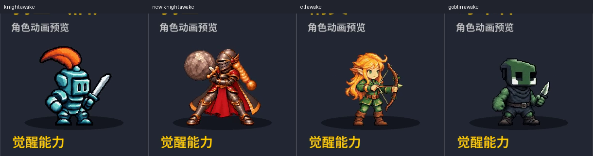

# Issue #28：三位旧角色的觉醒动画

用户已批准[方案](PLAN.md)。普通原样保留，仅新增旧骑士、精灵、哥布林的觉醒待机/施法各12独立姿势，共72帧。主 Issue #11 保持打开，最终视觉仍由用户评审。

## 版本与复现入口

- 开工基线：`c0aa438fa4077785706a26276795efbb93e886d6`，当时最新 origin/main，包含已合并 #31。
- 实现：`c6e5b9f81e4b62aed203152c9bc115641fabae4a`；本目录后续证据/工具提交不改变该运行时。精确源文件、debug/release/WASM 和 ZIP 哈希见 [source-binding.json](source-binding.json)。
- 正式 Windows 录像：[final/capture.json](final/capture.json)，逐场指令、视频/日志哈希、60Hz截图像素哈希俱全。`research/` 为开工觉醒基线，`baseline/` 为普通版回归基线。两者二进制均为已核实的 PR31 原二进制。
- 测量与截图统一使用 `tools/wizard_recording_frames.py::frames` 的 `fps=60` 采样流，编号 n 对应 n/60 秒；不混用原编码帧号。检查器逐像素复核导出截图确实来自同一采样流。
- 指定 Python：`.build-tools/python-path.txt`；图像依赖 `.build-tools/art-site`，录像依赖 `.build-tools/media-site`。`PYTHONUTF8=1`。正式场景由 `tools/capture_legacy_evidence.py` 驱动真实 Session 控制台，不重写战斗规则。

## 素材与实际尺寸

每人384×384帧，2304×1536图集，二值alpha、共用64色、最近邻、无损WebP。源图与实际提示词位于 `asset-sources/art-direction/characters/{knight-legacy,elf-legacy,goblin-legacy}/production/v1`。旧骑士施法最终源表v3；前两版的横伸边界、跨动作尺度、脚距问题已修复。精灵/哥布林源表v1。

导入器按源表固定密度校准，不逐帧拉伸或按武器外接框居中。脚线Y=336，角色独立可见高度约318/294/273；普通显示不变。每组12张真实源姿势，检查排除了整图平移重复；哈希检查不替代人工关节/装备观察。

| 角色 | 24姿势检查 | 待机接缝顺序11→12→1→2 | 档案 |
|---|---|---|---|
| 旧骑士 | [实际选角尺度](art/knight-legacy-poses.webp) | [接缝](art/knight-legacy-seam.webp) | [旧誓骑士](../../docs/art/characters/KNIGHT-LEGACY.md) |
| 精灵 | [实际选角尺度](art/elf-legacy-poses.webp) | [接缝](art/elf-legacy-seam.webp) | [林间游侠](../../docs/art/characters/ELF-LEGACY.md) |
| 哥布林 | [实际选角尺度](art/goblin-legacy-poses.webp) | [接缝](art/goblin-legacy-seam.webp) | [拾荒者](../../docs/art/characters/GOBLIN-LEGACY.md) |

装备逐帧观察：旧骑士盔缨、单剑完整且无新盾；精灵单弓、弦与搭弦箭保留，空手手势不放箭；哥布林单匕首与空手分离，无袋/兜帽/自伤。三组接缝及脚线已逐帧检查；材质、呼吸节奏、手势风格仍待用户最终视觉验收。

实际1280×900窗口的原尺寸裁图（未二次缩放）：

| 角色 | 觉醒选角前后 | 觉醒战斗前后 | 普通选角前后 |
|---|---|---|---|
| 旧骑士 | [对比](knight-awake-menu-before-after.webp) | [对比](knight-awake-battle-before-after.webp) | [对比](knight-normal-menu-before-after.webp) |
| 精灵 | [对比](elf-awake-menu-before-after.webp) | [对比](elf-awake-battle-before-after.webp) | [对比](elf-normal-menu-before-after.webp) |
| 哥布林 | [对比](goblin-awake-menu-before-after.webp) | [对比](goblin-awake-battle-before-after.webp) | [对比](goblin-normal-menu-before-after.webp) |

旧骑士青蓝方盔/橙缨/单剑，与新骑士黑红金甲/长辫/石剑在此尺寸下可直接区分；精灵空手施法与持弓臂分离，哥布林收拢空手与刀手分离。普通截图来自各自独立录像，待机相位可能不同，截图不充当像素一致证明；字节/逐帧一致由normal-check.json检查。源图通过内置imagegen生成，实际完整提示词按版本随源表保存。

## 六招时序

| 技能 | 真实生效阶段 | 动作时钟 |
|---|---|---|
| 冲锋 | 延后伤害 `skill_hit`，清除可更晚 | 1–6名义0.95秒、6等待；7接DamageApplied；余下0.45秒，不等清除 |
| 坚守 | 当下治疗77；随后消费纯治疗块 | 1–6名义0.4秒、6等待实际目标清除；7–12为1秒收束；空目标不等待 |
| 消除增幅 | 当下状态生效，不结束回合 | 12姿势1.4秒；不等未来消除；后续动作可接管 |
| 自然转化 | 当下转块/10治疗/25伤害，连锁另算 | 12姿势1.4秒；不因后续连锁/觉醒重播 |
| 区域掠夺 | 当下额外收益，随后初始2×2清除 | 1–6名义0.4秒、6张手等待；7对齐本次目标清除，余下1秒 |
| 魔力换血 | 当下治疗100，满血实际0 | 12姿势1.4秒，无清除等待 |

普通和新角色不订阅本批时钟。按实际游戏行动归属（不把暂停/资源编辑当新行动）、施法方、目标集合匹配通知。回滚清掉表现状态；含待冲锋快照只恢复剩余前摇，不重发模型伤害。终局未发生的清除不会补发收益，表现有界结束。棋盘冲锋替身只在本批觉醒读取同一施法帧。

## 自动检查与实际观察分开记录

**自动检查通过**：

- [普通保护数据](research/normal-lock.json) 及 `tools/check_legacy_normal_unchanged.py`：每人源图/atlas字节、解码逐帧像素、各自原序列/时长、整张缩略图与槽位、普通注册、基础规则配置及显示helper一致。故意改时长、索引、像素和注册均被拒绝。
- [素材检查](art/checks.json)：72独立姿势、无整图平移重复、二值透明、≤64色、装备安全边界、固定脚线。
- [两次完整重建](rebuild.json)：`tools/prepare_assets.py` 全量连续重建后，所有 assets 和手写src哈希不变。一次Windows文件写入短暂失败已重试恢复；最终两次连续成功结果才计入通过。
- [Rust](cargo-test.log)：主程序176通过、1既有忽略；两个规则probe各93通过。`tools/build.py` 中18项Python平衡测试通过。
- [debug headless](headless.log)、[release headless](release-headless.log)：每次134条权威模型JSONL事件，含编辑、移动、施法、回滚、AI、结算及批量对局。
- [自动对战基线](autoplay-baseline.csv) 与 [当前](autoplay-current.csv)：12局、seed280028、标准、roster0/1/3逐字节一致，SHA256 `9f140e847b2cf986a3b62d9b28046c8cb4d063729bc7473f987512d60912dd09`。
- GUI：[console](gui-console.log) 309事件、[ability events](gui-abilities.log)、[new roles](gui-roles.log)180事件均通过。
- [Windows/Web构建](build.log)：使用指定Python运行tools/build.py，ZIP内容完整、不包含asset-sources。Windows release和网页WASM大小/哈希见source-binding。
- [正式场景断言](final/scenario-checks.json)：41段录像哈希、34个战斗场景触发事件；三人回滚完整快照相等、待冲锋回滚仅一次己方命中、真实终局、真实觉醒切换及AI施法、空目标/无连锁/满血上限均核对真实Session事件。

**实际观察与录像测量**：

- [逐帧测量](final/pixel-measurements.json) 从真实像素识别施法姿势；六招无中断样本均观察到12姿势。健康/能力浮层遮挡区被明确排除，保留密集脸/手臂/躯干/腿部样本，并用抗局部浮层的80%像素误差统计。每个导出截图均与测量采样像素相等。
- 真实模型时间与录像相对时间分列。延迟掠夺/冲锋、暂停、终局、三人回滚、待冲锋恢复等场景见final/capture.json；终局胜利遮挡不冒充命中像素通过。
- 准备阶段暂停会冻结治疗浮字，因此正式脚本先在无输入的玩家回合运行3秒让浮字退场。预检录像不作为正式视觉验收，保留在本机忽略目录。
- [网页观察](web/observations.json)：实际WASM启动、三位觉醒选角、普通/觉醒页切换、960×675缩小窗口；浏览器warn/error日志为空。截图绑定同一WASM哈希。
- [Windows release启动](release-smoke/capture.json)：打包后的EXE启动，三位觉醒选角录像及截图已核对，与debug实战证据分别绑定二进制哈希。
- 时间测量保留异常：延迟冲锋以首个可见姿势为起点得到1.116667秒，模型事件间隔1.050947秒，相差65.72ms，超过3个60Hz采样；该相对时间检查为失败，不能当绝对命中校准。逐帧实际观察[样本112→113](charge-delayed-landmarks.webp)：伤害165反馈、冲锋专精反馈与第7姿势在同一可见采样113出现。其余五段命中/清除相对测量差在3个采样内。录像卡顿/取样起点误差仍保留在原始证据中。

**待用户视觉验收 / 未验证**：旧骑士细像素金属与新骑士辨识度、精灵弓臂、哥布林刀手、0.72秒待机节奏、普通/觉醒脚线切换观感；三人介绍沿用既有文案，原始用户设定来源待补。macOS GUI无本地Mac，未验证；网页完整实战矩阵未单独重跑，Windows实战与同一权威模型已验证。

## 独立审查与macOS

自查完成后执行用户指定的一个medium独立审查，记录精确base/head、问题归因与修复复验；结果追加于本目录。macOS由Draft PR工作流构建/测试/headless/打包，下载核验后补充。此段不代表未运行步骤已经通过。
